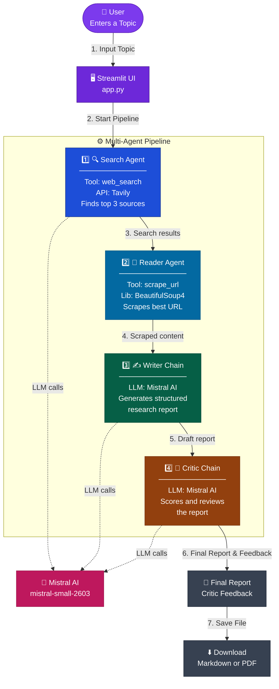

# Multi-Agent Research Assistant

A four-agent AI pipeline that automates end-to-end research from live web search to a structured, reviewed report; built with LangChain, Mistral AI, Tavily, and Streamlit.

---

## How It Works

The pipeline runs four specialized agents in sequence:

```
User Query
    │
    ▼
┌──────────────┐
│ Search Agent  │  ──→  Finds top 3 sources via Tavily web search
└──────────────┘
    │
    ▼
┌──────────────┐
│ Reader Agent  │  ──→  Scrapes and extracts content from the best URL
└──────────────┘
    │
    ▼
┌──────────────┐
│ Writer Chain  │  ──→  Drafts a structured report (intro, findings, conclusion)
└──────────────┘
    │
    ▼
┌──────────────┐
│ Critic Chain  │  ──→  Scores the draft, identifies weaknesses, refines output
└──────────────┘
    │
    ▼
Final Report (Markdown or PDF)
```

### Key Design Decisions
- **Self-correcting output** — the Critic Chain reviews and scores every draft before delivery, reducing unsupported claims
- **Dual LLM usage** — Mistral AI handles both writing and critique in separate chains to avoid self-review bias
- **Downloadable reports** — output delivered as formatted Markdown or PDF

---

## 🏗️ Architecture



### 🔄 Step-by-Step Flow Explanation

1. **Input Topic:** The user enters a research topic into the Streamlit UI.
2. **Start Pipeline:** The UI passes the topic to the Multi-Agent Pipeline, triggering the first agent.
3. **Search Results:** The **Search Agent** uses the Tavily API to find the most relevant and recent online sources, passing these URLs and snippets to the next step.
4. **Scraped Content:** The **Reader Agent** reviews the search results to find the best URL and uses BeautifulSoup4 to scrape the full webpage text.
5. **Draft Report:** The **Writer Chain** takes the search summaries and the full scraped content, sending them to the Mistral LLM to generate a well-structured markdown report.
6. **Final Report & Feedback:** The **Critic Chain** evaluates the draft report using the Mistral LLM, providing a score, strengths, and areas for improvement.
7. **Save File:** The final output is rendered in the UI, where the user can read it and download it as either a Markdown (`.md`) or PDF file.

---

## 🛠 Tech Stack

| Component | Technology |
|---|---|
| Agent Framework | LangChain |
| LLM | Mistral AI (`mistral-small`) |
| Web Search | Tavily API |
| Web Scraping | BeautifulSoup4 |
| PDF Generation | ReportLab |
| UI | Streamlit |
| Language | Python 3.10+ |

---

## 📁 Project Structure

```
Multi_Agent_System/
├── app.py            # Streamlit web UI
├── agents.py         # Agent and chain definitions
├── tools.py          # Tavily search and scraping tools
├── pipeline.py       # CLI runner
├── requirements.txt
├── .env.example
└── README.md
```

---

## 🚀 Getting Started

### Prerequisites
- Python 3.10+
- Mistral AI API key → [console.mistral.ai](https://console.mistral.ai)
- Tavily API key → [tavily.com](https://tavily.com)

### Installation

```bash
# 1. Clone the repository
git clone https://github.com/armankhan8150/Multi-Agent-Research-Assistant.git
cd Multi-Agent-Research-Assistant

# 2. Create a virtual environment
python -m venv venv
source venv/bin/activate  # Windows: venv\Scripts\activate

# 3. Install dependencies
pip install -r requirements.txt

# 4. Set up environment variables
cp .env.example .env
# Add your API keys to .env
```

### Environment Variables

```env
MISTRAL_API_KEY=your_mistral_api_key
TAVILY_API_KEY=your_tavily_api_key
```

### Run

```bash
# Web UI
streamlit run app.py

# Command line
python pipeline.py
```

---

## 💡 Example Output

**Input:** `"What are the latest developments in LLM agent frameworks?"`

**Output:** A structured report with:
- Introduction and research context
- Key findings from scraped sources
- Conclusion and synthesis
- Critic score and improvement notes
- Downloadable as Markdown or PDF

---

## 🗺 Roadmap

- [ ] Parallel multi-source reading (Reader Agent)
- [ ] Source citation with URLs in final report
- [ ] Support for OpenAI models as alternative LLM
- [ ] Export to Notion

---

## 👤 Author

**Arman Malik** — AI Engineer
[LinkedIn](https://linkedin.com/in/arman-malik) · [GitHub](https://github.com/armankhan8150)

---

## 📄 License

MIT License — see [LICENSE](LICENSE) for details.


## 🙌 Author

Made with ❤️ — contributions and feedback welcome!
